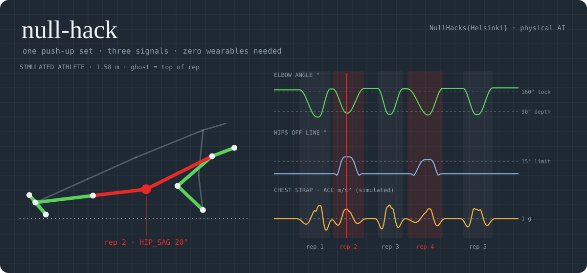
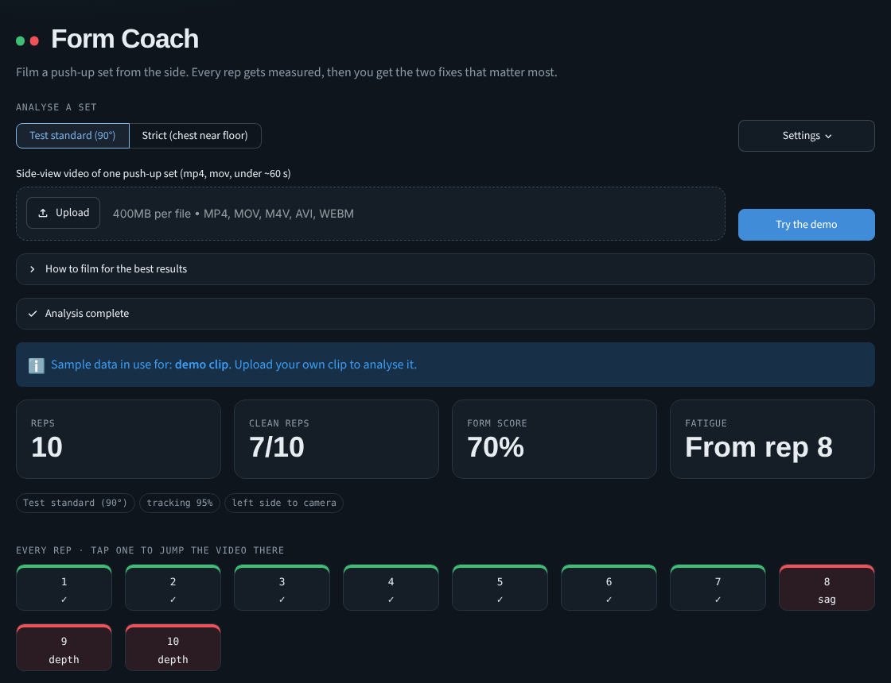
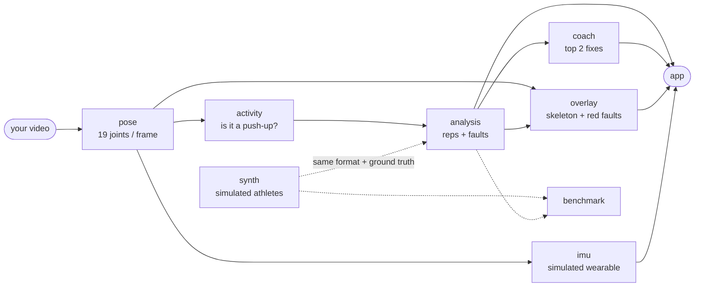

<p align="center">
  
</p>

<p align="center">
  <b>Film a push-up set from the side. Every rep is measured, every fault is timestamped,<br>
  and the same clip becomes labelled training data for a wearable you never wore.</b>
</p>

<p align="center">
  <code>15 / 15 reps on a real set in baggy clothes</code>&nbsp;
  <code>6 / 6 on a second real clip</code>&nbsp;
  <code>59 tests</code>&nbsp;
  <code>runs locally</code>
</p>

<p align="center">
  <a href="#quick-start">Quick start</a> ·
  <a href="#what-you-get">What you get</a> ·
  <a href="#how-it-works">How it works</a> ·
  <a href="#accuracy">Accuracy</a> ·
  <a href="#physical-ai-simulated-athletes-and-wearables">Physical AI</a> ·
  <a href="CONTRACT.md">Contract</a>
</p>

<br>

## Why

Ask a general chatbot to review a workout video and it samples about one frame a second, misses the
bottom of most reps, and can't measure an angle. You get *"keep your core tight"* whatever you did.

Form Coach measures first and talks second. A pose model tracks 19 joints in **every frame**, fixed
biomechanics rules score **every rep**, and only then does an LLM (optional) turn the numbers into
coaching. It can't invent a problem, because it only sees what was measured.

Built in five hours at **NullHacks{Helsinki}** for the theme *physical AI: simulate the data you find cool*.

## Quick start

```bash
python -m venv .venv
.venv\Scripts\activate            # macOS / Linux: source .venv/bin/activate
pip install -r requirements.txt
streamlit run app.py              # opens http://localhost:8501
```

Press **Try the demo**, or upload your own clip. For Claude-written coaching, add
`ANTHROPIC_API_KEY=...` to a `.env` file; without it the rule-based coach runs fully offline.

> **Filming:** side view, phone in landscape on the floor, 2–3 m away, head to heels in frame.
> Loose clothes are fine. Getting into position and standing up afterwards are ignored automatically.

## What you get

<p align="center">
  
</p>

| | |
|---|---|
| **Scoreboard** | One tile per rep, green or red with the fault. Click one and the video jumps there. |
| **Skeleton overlay** | Your video with the tracked skeleton; the joints involved turn red while a fault is happening. Rep counter and elbow angle on screen. |
| **Coach** | The two fixes that matter most, with the reps they happened on and a cue to remember. Claude or rule-based. |
| **Angles** | Elbow angle and hip line across the set, with the targets and every flagged rep marked. |
| **Wearable (simulated)** | What a chest strap and a smartwatch would have recorded during your set. |
| **Two standards** | *Test* (90° at the elbow) or *Strict* (chest near the floor). Settings has a 2× faster tracking mode. |

**Faults it detects**

| Code | What it means | Judged against |
|---|---|---|
| `SHALLOW` | Didn't go deep enough | 90° elbow (75° strict) |
| `NO_LOCKOUT` | Arms never straightened at the top | 160° (165° strict), or your own best lockout if the tracker under-reads you |
| `HIP_SAG` / `HIP_PIKE` | Hips dropped below / rose above your body line | ±15° (12° strict) from *your own* line at the top of each rep |
| `HEAD_DROP` | Head hung below the body line | 25° below your own head position |
| `FAST_DESCENT` | Dropped into the bottom | about 0.4 s |

Judging hips, head and lockout against your own top position is what makes loose clothing work:
the tracker puts the hip on the fabric, a fixed straight-line rule calls that a sag, a personal
baseline doesn't.

## How it works



| Module | Job |
|---|---|
| `pose.py` | MediaPipe pose per frame → 19 landmarks in pixels and metres; removes one-frame jumps (fabric, occlusion) before smoothing |
| `activity.py` | Finds where you're actually in push-up position (body horizontal, legs straight, hands on the floor); trims setup, kneeling and standing up |
| `analysis.py` | Reps from elbow-angle valleys, then the six faults and the rep where fatigue sets in |
| `coach.py` | Turns the analysis into a headline, two priorities and cues; Claude if a key is set |
| `overlay.py` · `video.py` | Skeleton video in browser-playable H.264 · all file and codec handling |
| `synth.py` · `imu.py` · `benchmark.py` | Simulated athletes · simulated wearables · scoring against ground truth |
| `app.py` | The Streamlit app |

Every arrow is one data format, defined once in [`CONTRACT.md`](CONTRACT.md).

## Accuracy

**Real clips**

| Clip | Ground truth | Result |
|---|---|---|
| Side view, loose hoodie and trousers, kneels up at the end | 15 reps (hand-counted) | **15 reps**, every bottom within 0.4 s of the hand count; kneeling ignored; no false hip sag |
| Side view, beach, slow reps with long holds | 6 reps | **6 reps** |
| Multiple people, camera cuts, hand-release push-ups | ~2 visible | recognised as push-ups, 2 incomplete reps |

**Simulated** (`python benchmark.py`): 120 athletes, random cameras up to 25° off side view at
24–60 fps with jitter and dropped frames, mixed faults, half in baggy clothes.

| | |
|---|---|
| Rep count exactly right | 120 / 120 clips |
| `SHALLOW` `NO_LOCKOUT` `HIP_SAG` `HIP_PIKE` `HEAD_DROP` | 100 % precision and recall |
| `FAST_DESCENT` | 100 % precision, 90 % recall |
| False hip sag on clean reps in baggy clothes | 4.4 % with a fixed straight-line rule → **0 %** with the personal baseline |

The simulated clips are scored with the same fault definitions they were generated from, so treat
them as a regression test of the pipeline; the real clips are the real-world evidence.

## Physical AI: simulated athletes and wearables

**Simulated athletes.** `synth.generate(n, faults=..., camera=..., clothing=...)` builds each
athlete from body proportions and drives the elbow through every rep; the shoulder sits where an arm
of that bend meets a rigid body line, so the motion is physically consistent rather than drawn.
Faults, fatigue, camera angle, frame rate, jitter, dropped detections and **loose clothing** are
randomised, and every clip carries exact ground truth. `synth.export()` writes a zip with
`samples.jsonl`, `frames.csv`, `reps.csv` and a datasheet.

**Simulated wearables.** `imu.simulate(landmarks)` places a chest strap, waist clip and smartwatch on
the tracked body, converts pixels to metres from the body's own size and differentiates twice. The
accelerometers read gravity at rest, the gyroscope reads segment rotation, and seeded noise mimics a
consumer IMU. One phone video becomes pose data, wearable data and per-rep labels.

```python
import synth, imu
athletes = synth.generate(n=50, clothing="random")      # ~0.2 s per athlete
wearable = imu.simulate(athletes[0]["landmarks"])       # chest / hip / wrist
synth.export(athletes, "outputs", with_imu=True)        # -> outputs/synth_dataset.zip
```

## Tests

```bash
python -m pytest -q tests
```

59 tests, written against independent facts rather than the code's own maths: hand-counted reps on
real clips, known physics (a still sensor reads 9.81 m/s²; a 10 cm, 1 Hz bounce peaks at 3.95 m/s²),
every simulated fault found on exactly its labelled reps, the overlay turning a joint red only while
its fault is active, and a one-frame landmark jump removed while real motion passes untouched.

## Status

| | |
|---|---|
| ✅ Working | pose, activity, analysis, coach, overlay, video, app (dark UI), synth, imu, benchmark |
| 🗺️ Next | `physics.py` (joint loads), a Sim Lab tab, more hand-labelled real clips, syncing a real wearable |

<details>
<summary><b>Repository layout</b></summary>

```
app.py              Streamlit app (theme in .streamlit/config.toml)
pose.py             video -> landmarks          activity.py   push-up or not, segments
analysis.py         reps, faults, fatigue       coach.py      feedback (rules or Claude)
overlay.py          skeleton video              video.py      uploads, H.264, frame grabs
synth.py            simulated athletes          imu.py        simulated wearables
benchmark.py        score analysis vs truth
CONTRACT.md         data formats between modules
samples/            demo clips, real landmarks (incl. the 15-rep baggy-clothes set), mock data
models/             MediaPipe pose models
tests/              pytest suite
docs/               research notes, PRD, header image generator (docs/assets/make_hero.py)
```

</details>
