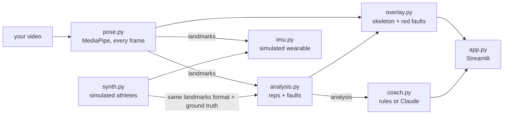

<p align="center">
  
</p>

<p align="center"><b>Film a push-up set from the side. Every rep gets measured, coached,<br>and turned into labelled training data, including the wearable data you never recorded.</b></p>

<p align="center">
  <a href="#run-it">Run it</a> ·
  <a href="#what-it-does">What it does</a> ·
  <a href="#how-it-works">How it works</a> ·
  <a href="#the-physical-ai-part">Physical AI</a> ·
  <a href="#status">Status</a> ·
  <a href="CONTRACT.md">Module contract</a>
</p>

---

## Why this exists

Upload a workout video to a general chatbot and it doesn't really watch it: it samples about one frame
per second, so it misses the bottom of most reps, and it can't measure a joint angle. You get
"keep your core tight" whatever you did.

null-hack splits the job. A pose model measures **every frame**, fixed biomechanics rules score
**every rep** with real angles, and only then does an LLM turn those numbers into coaching. The LLM
can't invent a problem, because it only sees what was measured.

Built in five hours at **NullHacks{Helsinki}** for the theme *physical AI: simulate the data you find cool*.

## What it does

| | For whom | What you get |
|---|---|---|
| **Form coach** | Anyone doing push-ups | Upload a side-view clip → skeleton overlay with faults lit up red at the moment they happen, a per-rep scorecard with timestamps, elbow and hip charts, and the two fixes that matter most |
| **Simulated athletes** | People training form models | A kinematic body that does push-ups with random height, tempo, depth, camera angle and injected faults, plus exact ground truth for every rep |
| **Simulated wearable** | People building smartwatch / chest-strap coaches | The accelerometer and gyroscope signal a chest strap, waist clip and watch *would* have recorded, from any real or simulated clip |

Faults it knows, everywhere in the code:

| Code | Meaning |
|---|---|
| `SHALLOW` | Elbow never bends past the depth target (90°) |
| `NO_LOCKOUT` | Arms never straighten at the top (160°) |
| `HIP_SAG` | Hips drop more than 15° below the shoulder–ankle line |
| `HIP_PIKE` | Hips rise more than 15° above it |
| `HEAD_DROP` | Head hangs well below the body line |
| `FAST_DESCENT` | Lowering takes under ~0.4 s |

## Run it

Python 3.10+.

```bash
python -m venv .venv
# Windows: .venv\Scripts\activate      macOS/Linux: source .venv/bin/activate
pip install -r requirements.txt
streamlit run app.py
```

Click **Try the demo** to see a full report without filming anything. To use the LLM coach, put
`ANTHROPIC_API_KEY=...` in a `.env` file; without it you get the rule-based coach, which always works offline.

**Filming your own clip:** side view, phone in landscape, 2–3 m away at hip height, whole body
from head to heels in frame, one person, under 30 seconds. If the body isn't clear enough to judge,
the app says so and doesn't guess.

## How it works



Each arrow is one data format, defined once in [`CONTRACT.md`](CONTRACT.md). Because `synth.py`
emits exactly what `pose.py` emits, everything downstream runs on real and simulated clips alike,
and simulated clips come with answers to check against.

| Module | Job |
|---|---|
| `pose.py` | Video → 19 body landmarks per frame, in pixels and in metres |
| `analysis.py` | Landmarks → reps, angles, faults, fatigue point |
| `coach.py` | Analysis → headline, top two fixes with cues, per-rep notes |
| `overlay.py` | Draws the skeleton on your video; joints turn red during a fault; rep counter and elbow angle on screen |
| `video.py` | The only module that touches video files: saves uploads, makes browser-playable H.264, grabs frames |
| `synth.py` | Simulated athletes and dataset export |
| `imu.py` | Simulated chest / hip / wrist IMU |
| `app.py` | The web app |

## The physical-AI part

**Simulated athletes.** `synth.generate(n, faults=..., camera=...)` builds each athlete from body
proportions, drives the elbow angle through every rep, and places the shoulder where an arm of that bend
meets a rigid body line, so the motion is physically consistent rather than drawn. Faults, fatigue
(form breaking down from rep *N*), camera yaw and roll, resolution, frame rate, keypoint jitter and
dropped detections are all randomised. `synth.export()` writes a zip with `samples.jsonl`, `frames.csv`,
`reps.csv` and a datasheet.

**Simulated wearable.** `imu.simulate(landmarks)` puts virtual sensors on the shoulder, hip and wrist,
converts pixels to metres from the body's own size, and differentiates position twice. Accelerometers
read specific force (a sensor lying still reads 9.81 m/s² up), the gyroscope reads how fast the sensor's
body segment rotates, and seeded noise and bias mimic a consumer IMU. One phone video becomes pose
data, wearable data and per-rep labels.

```python
import synth, imu
athletes = synth.generate(n=50, seed=0)                 # ~0.2 s per athlete
wearable = imu.simulate(athletes[0]["landmarks"])       # chest / hip / wrist
synth.export(athletes, "outputs", with_imu=True)        # -> outputs/synth_dataset.zip
```

## Proof it works

```bash
python -m pytest -q tests
```

The tests check behaviour against independent facts, not against the code's own maths:

- every injected fault is measurable in the reps labelled with it (and absent from the clean ones), and clean reps are counted exactly
- a still sensor reads 9.81 m/s²; a 10 cm, 1 Hz bounce gives the textbook 3.95 m/s² peak; a torso rotating at 30°/s reads 30°/s
- the overlay is H.264, keeps every frame, and turns the hip red only while `HIP_SAG` is active
- uploads are content-addressed; frame grabs return the right frame

## Status

| | |
|---|---|
| ✅ Done | `pose.py`, `coach.py`, `app.py`, `overlay.py`, `video.py`, `synth.py`, `imu.py` |
| 🚧 In progress | `analysis.py` (until it lands, the app falls back to `samples/sample_analysis.json` and shows a yellow banner) |
| 🗺️ Next | `physics.py` (joint loads), `benchmark.py` (score the analyzer on simulated ground truth), a Sim Lab tab in the app, real wearable sync |

## Repository

```
app.py  pose.py  coach.py  overlay.py  video.py  synth.py  imu.py
CONTRACT.md        the data formats between modules (start here if you're contributing)
samples/           demo clips, real landmarks, mock analysis for the demo
models/            MediaPipe pose models
tests/             pytest suite
docs/              research notes, PRD, the script that draws the header image
```

The header image is generated from real output: `python docs/assets/make_hero.py`.
